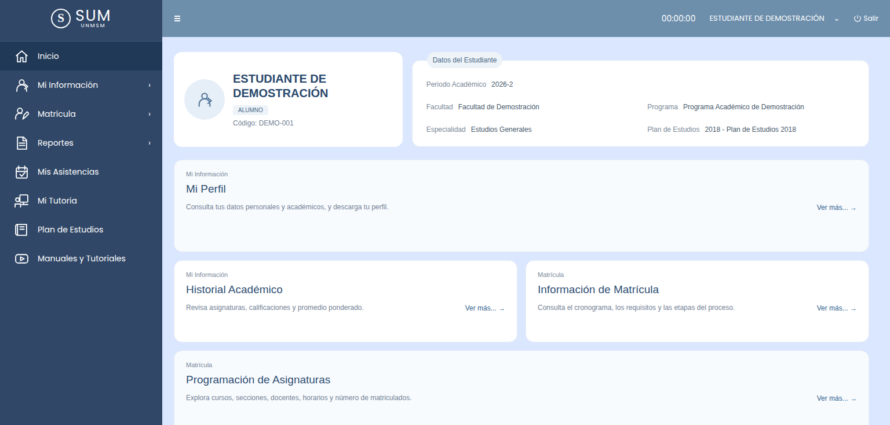
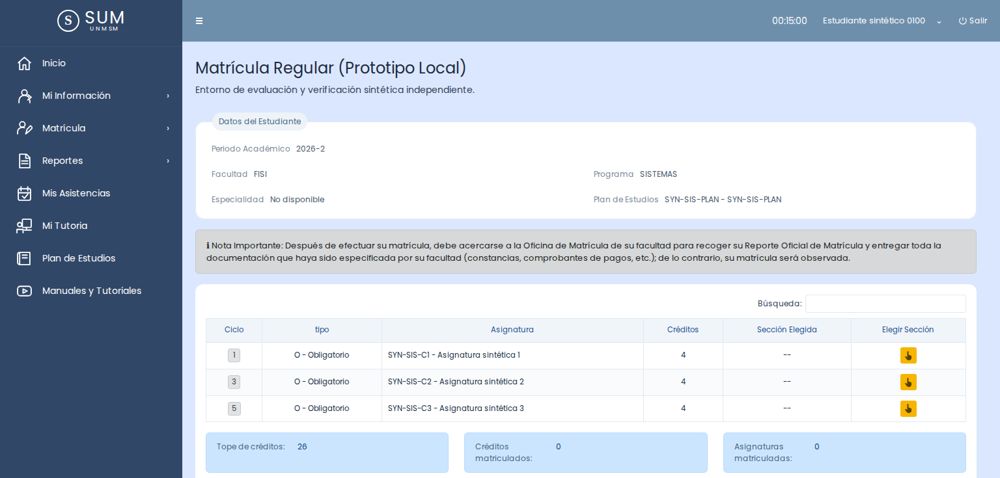

# SUM local: réplica del SUM del estudiante

Réplica independiente del **Sistema Único de Matrícula (SUM) de la UNMSM en su
vista de estudiante**, construida con React y NestJS sobre **datos sintéticos**.
Reproduce lo que el estudiante ve y hace en el SUM, desde consultar su perfil y
su historial hasta matricularse, y emula la matrícula regular de FISI 2026-II
sin conectarse al SUM real.

> No está afiliada a la UNMSM, no reemplaza al SUM y no genera documentos con
> valor legal. Ningún reporte de esta réplica sustituye al reporte oficial.

| Inicio del estudiante | Matrícula regular (prototipo local) |
| --- | --- |
|  |  |

## Contenido

- [Del análisis a la réplica](#del-análisis-a-la-réplica)
- [Pantallas replicadas](#pantallas-replicadas)
- [Concordancia entre requisitos e interfaces](#concordancia-entre-requisitos-e-interfaces)
- [Hallazgos del análisis y cómo los trata la réplica](#hallazgos-del-análisis-y-cómo-los-trata-la-réplica)
- [Verificación](#verificación)
- [Cómo ejecutarla](#cómo-ejecutarla)
- [Documentación](#documentación)
- [Contribuir y licencia](#contribuir-y-licencia)

## Del análisis a la réplica

El proyecto avanza en tres capas que se apoyan entre sí:

1. **Análisis del sistema.** [`SITUACION-SUM.md`](SITUACION-SUM.md) estudia la
   problemática de la matrícula frente a la Ley 30220 y el Reglamento General de
   Matrícula 2026, y la traduce en catorce requisitos funcionales (RF-01 a RF-14).
   El [dossier FISI 2026-II](docs/domain/fisi/2026-II/README.md) concreta esas
   reglas para una facultad y un periodo.
2. **Evidencia de las interfaces.** Cada pantalla del SUM tiene notas de
   estructura, medidas e interacciones en [`evidence/sum/`](evidence/sum/), y su
   versión local en [`evidence/local/`](evidence/local/).
3. **Implementación.** El frontend (`client/`) replica las pantallas y consume una
   API propia (`backend/`) con contratos documentados en
   [`docs/reverse-engineering/contracts/local-api/`](docs/reverse-engineering/contracts/local-api/).

Cada regla se etiqueta por su origen: **norma** publicada, **observación** de la
interfaz, **testimonio** de estudiantes, **inferencia** o **decisión local** de la
réplica. Lo que no tiene respaldo queda como pregunta abierta en lugar de
inventarse.

## Pantallas replicadas

Todas las pantallas del menú del estudiante están implementadas. Salvo Manuales, que
es estático, se alimentan de la API propia con datos sintéticos.

| Menú | Pantalla | Ruta local | Evidencia |
| --- | --- | --- | --- |
| Inicio | Inicio | `/alumnoWebSum/v2/inicio` | [home](evidence/sum/home/) |
| Mi Información | Mi Perfil | `/alumnoWebSum/v2/informacion/perfil` | [perfil](evidence/sum/perfil/) |
| Mi Información | Formulario de datos | `/alumnoWebSum/v2/informacion/formularioDatos` | [formulario-datos](evidence/sum/formulario-datos/) |
| Mi Información | Ficha socioeconómica | `/alumnoWebSum/v2/informacion/fichaSocioeconomica` | [ficha-socioeconomica](evidence/sum/ficha-socioeconomica/) |
| Mi Información | Historial académico | `/alumnoWebSum/v2/informacion/historial` | [historial](evidence/sum/historial/) |
| Matrícula | Información de matrícula | `/alumnoWebSum/v2/matricula/informacion` | [matricula-informacion](evidence/sum/matricula-informacion/) |
| Matrícula | Programación de asignaturas | `/alumnoWebSum/v2/matricula/programacion` | [programacion-asignaturas](evidence/sum/programacion-asignaturas/) |
| Reportes | Prematrícula | `/alumnoWebSum/v2/reportes/prematricula` | [reportes-prematricula](evidence/sum/reportes-prematricula/) |
| Reportes | Matrícula | `/alumnoWebSum/v2/reportes/matricula` | [reportes-matricula](evidence/sum/reportes-matricula/) |
| Reportes | Horarios | `/alumnoWebSum/v2/reportes/horarios` | [reportes-horarios](evidence/sum/reportes-horarios/) |
| Reportes | Evaluaciones | `/alumnoWebSum/v2/reportes/evaluaciones` | [reportes-evaluaciones](evidence/sum/reportes-evaluaciones/) |
| Reportes | Deudas | `/alumnoWebSum/v2/reportes/deudas` | [reportes-deudas](evidence/sum/reportes-deudas/) |
| Mis Asistencias | Asistencias | `/alumnoWebSum/v2/asistencia` | [asistencia](evidence/sum/asistencia/) |
| Mi Tutoría | Tutoría | `/alumnoWebSum/v2/tutoria` | [tutoria](evidence/sum/tutoria/) |
| Plan de Estudios | Plan de estudios | `/alumnoWebSum/v2/planEstudios` | [plan-estudios](evidence/sum/plan-estudios/) |
| Manuales y Tutoriales | Manuales | `/alumnoWebSum/v2/manuales` | [manuales](evidence/sum/manuales/) |

Además, la réplica agrega pantallas propias, identificadas como prototipo local:

| Pantalla | Ruta | Especificación |
| --- | --- | --- |
| Acceso con estudiantes sintéticos y escenarios | `/local/login` | [spec 002](specs/002-local-profile-dashboard/) |
| Matrícula regular: prematrícula, turno, selección, validación y confirmación | `/local/matricula-regular` | [spec 001](specs/001-matricula-regular-fisi/) |
| Reporte de la matrícula confirmada | `/local/matricula-regular/reporte/:id` | [contrato](docs/reverse-engineering/contracts/local-api/matricula-regular.md) |

La fidelidad visual se reconstruyó a partir de notas estructurales y de capturas
locales. No se declara paridad píxel a píxel con el SUM.

## Concordancia entre requisitos e interfaces

El [análisis](SITUACION-SUM.md#5-matriz-de-requisitos-funcionales) cubre todo el
proceso de matrícula, incluida la gestión que hacen la facultad y las oficinas.
El SUM replicado es la **vista del estudiante**, así que cada requisito se divide
en la parte que el estudiante ve o ejecuta y la parte administrativa, que no le
corresponde a esta interfaz.

**Estados:** ✅ cubierto · 🟡 parcial · ⬜ no implementado · — no aplica al estudiante.

| ID | Requisito del análisis | Qué ve o hace el estudiante en la réplica | Estado | Parte administrativa fuera de alcance |
| --- | --- | --- | --- | --- |
| RF-01 | Horarios con validación de cruce | Consulta los horarios en Programación y en el Reporte de horarios. Si elige secciones que se cruzan, la matrícula se rechaza (`SCHEDULE_CONFLICT`). | ✅ | Repositorio central de horarios de la facultad. |
| RF-02 | Vínculo sección–docente | Ve el docente de cada sección en Programación y al elegir sección. | ✅ | Historial de cambios de docente. |
| RF-03 | Cupos por sección | Ve el tope y los matriculados por sección. Si se agota el cupo, su matrícula se rechaza (`SECTION_FULL`) sin sobre-matrícula, incluso con muchos estudiantes a la vez. | ✅ | Lista de espera: es una mejora propuesta que el SUM no tiene. |
| RF-04 | Sílabo semanal por sección | El SUM del estudiante no muestra sílabos. | — | Registro y seguimiento del sílabo. |
| RF-05 | Aulas | Ve el aula de cada sección y de cada horario. | ✅ | Validar capacidad del aula y evitar doble reserva. |
| RF-06 | Rango de créditos por perfil | Ve su «Tope de créditos». La matrícula exige entre 12 y 26 créditos en FISI 2026-II (`CREDIT_LOAD_INVALID`) y admite una excepción autorizada. | 🟡 | Autorizar excepciones. |
| RF-07 | Repitencia y tutoría | Debe priorizar cursos desaprobados (`RETAKE_PRIORITY`). Se le exige tutoría (`TUTORSHIP_REQUIREMENT_UNMET`) y en cuarta matrícula solo esa asignatura, o hasta 12 créditos con autorización (`FOURTH_ENROLLMENT_RULE_UNMET`). | ✅ | Alertas al Vicedecanato y resoluciones. |
| RF-08 | Trámites presenciales o virtuales | Rectificación, reserva, extemporánea y retiro no se emulan. | ⬜ | Autorización por Vicedecanato, Consejo o VRAP. |
| RF-09 | Promedio ponderado | Ve su ponderado en Historial académico y Mi Perfil. | ✅ | Publicar el ranking por tercio, quinto y décimo superior. |
| RF-10 | Turno de matrícula según ponderado | Ve el cuadro de turnos de FISI 2026-II. Fuera de su turno no puede matricularse (`OUTSIDE_WINDOW`). | ✅ | Definir y aprobar los turnos. |
| RF-11 | Reporte de matrícula | Al confirmar obtiene su reporte, que indica que no es un documento oficial ni equivale a un visado. | ✅ | Visado del Vicedecanato y firma digital. |
| RF-12 | Actas promocionales | El estudiante no gestiona actas. | — | Cierre de actas y actas adicionales. |
| RF-13 | Prematrícula antes de matricular | Consulta su reporte de prematrícula. Solo puede matricularse si la prematrícula está habilitada (`PRE_ENROLLMENT_NOT_ENABLED`) y en cursos prematriculados (`COURSE_NOT_IN_PRE_ENROLLMENT`). Horario, créditos y repitencia se validan antes de confirmar. | ✅ | — |
| RF-14 | Integración con el SUM en modo lectura | La réplica nunca escribe en el SUM ni lo consulta en ejecución. El operador puede cargar sus propios datos exportados solo para lectura ([guía](docs/operador.md)). | ✅ | — |

**Resumen:** de los 12 requisitos que tocan la vista del estudiante, 10 están
cubiertos, 1 es parcial y 1 no está implementado. La parte parcial de RF-06 son
los regímenes anual y de verano, que no se modelan; lo no implementado son los
trámites de RF-08. RF-04 y RF-12 son puramente administrativos.

La matrícula valida además reglas que el estudiante encuentra en el proceso y
que salen del dossier FISI, aunque el análisis no las listaba: deudas, requisito
de salud, plan de estudios distinto, prerrequisitos y matrícula ya registrada.
El catálogo completo de causas está en
[`shared/matricula-regular.mjs`](shared/matricula-regular.mjs).

## Hallazgos del análisis y cómo los trata la réplica

| Hallazgo del análisis | Tratamiento en la réplica |
| --- | --- |
| La Ley 30220 y el Reglamento 2026 se contradicen en la repitencia | Aplica la «cuarta matrícula» del Reglamento ([RN-09](docs/domain/fisi/2026-II/business-rules.md)). Si falta la autorización o el dato de tutoría, devuelve `REPETITION_OR_AUTHORIZATION_UNKNOWN` en vez de decidir por su cuenta. |
| No hay regla publicada que use el ponderado para ordenar la matrícula | Para FISI 2026-II sí existe un cuadro publicado con turnos por ponderado. La réplica lo transcribe con su fuente; otras facultades y periodos quedan sin perfil. |
| Riesgo de documentos paralelos al reporte oficial | El reporte y las pantallas propias se marcan como «Prototipo Local» y el proyecto declara que no tiene valor legal. |
| Horarios, cupos y aulas dispersos entre facultades | Es un problema de gestión; la réplica solo centraliza por sección lo que el estudiante consulta. |
| Vacío sobre qué trámites requieren presencia | Sigue abierto: los trámites no se emulan. |

Las preguntas sin resolver están en
[`open-questions.md`](docs/domain/fisi/2026-II/open-questions.md).

## Verificación

- **Cupos bajo concurrencia:** 10 rondas de 100 estudiantes compitiendo por una
  sección de 10 plazas, con 1.000 intentos. Resultado: 100 aceptaciones, 900
  rechazos `SECTION_FULL` y cero sobre-matrículas, comprobado con auditoría SQL
  ([informe](evidence/local/simulador-produccion/fullstack-verification.md)).
- **Doble clic y reintentos:** 20 reenvíos simultáneos de la misma solicitud
  producen una sola matrícula.
- **Caída del servidor a mitad de una matrícula:** no deja registros parciales.
- **Escenarios con 400 estudiantes:** la integridad se cumple en todos. Los
  tiempos de respuesta no cumplen el objetivo en los escenarios de mayor
  contención ([resultados](evidence/local/simulador-produccion/scenarios-400/verification.md)).
- **CI:** cada PR compila y prueba el frontend y el backend.

Todo se midió en un entorno local con datos sintéticos. No acredita la
capacidad ni el comportamiento interno del SUM real.

## Cómo ejecutarla

Solo necesitas Docker con Docker Compose:

```sh
docker compose -f compose.local.yaml up --build
```

Abre **http://localhost:5180**, elige un escenario y un estudiante sintético y
pulsa **Iniciar prueba**. Hay nueve escenarios de matrícula con perfiles de
Ingeniería de Sistemas y de Software. Para detenerlo:
`docker compose -f compose.local.yaml down`. Si el puerto está ocupado:
`SUM_PORT=5182 docker compose -f compose.local.yaml up --build`.

En la consola del navegador puedes cambiar de modo:

```js
MODE = SIM // Selector de escenarios y estudiantes (predeterminado)
MODE = DEV // Solo las pantallas SUM, sin selector
```

### Desarrollo con recarga automática

Con Node 24 y pnpm:

```sh
pnpm --dir client install --frozen-lockfile
pnpm --dir backend install --frozen-lockfile
pnpm --dir backend start:dev
pnpm --dir client dev:local
```

### Simulador de carga con PostgreSQL y Grafana

```sh
docker compose up --build -d   # web en :5189, Grafana en :5190
docker compose run --rm k6      # prueba de cupos
```

El resultado esperado es 10 aceptaciones y 90 rechazos por cupo. Detalles en la
[guía del simulador](infra/simulator/README.md).

## Documentación

| Tema | Dónde |
| --- | --- |
| Análisis del sistema y requisitos | [`SITUACION-SUM.md`](SITUACION-SUM.md) |
| Reglas, proceso y fuentes de FISI 2026-II | [`docs/domain/fisi/2026-II/`](docs/domain/fisi/2026-II/) |
| Especificaciones | [`specs/`](specs/) |
| Contratos de la API propia | [`docs/reverse-engineering/contracts/local-api/`](docs/reverse-engineering/contracts/local-api/) |
| Evidencia por pantalla | [`evidence/sum/`](evidence/sum/) y [`evidence/local/`](evidence/local/) |
| Sistema de diseño | [`client/DESIGN_SYSTEM.md`](client/DESIGN_SYSTEM.md) |
| Backend | [`backend/README.md`](backend/README.md) |
| Datos propios del operador | [`docs/operador.md`](docs/operador.md) |

## Contribuir y licencia

Lee [CONTRIBUTING.md](CONTRIBUTING.md) antes de abrir un PR. El código se publica
bajo la licencia [MIT](LICENSE). Este proyecto no está afiliado a la UNMSM; los
nombres, logotipos y capturas del SUM pertenecen a sus titulares y no quedan
cubiertos por esa licencia.
