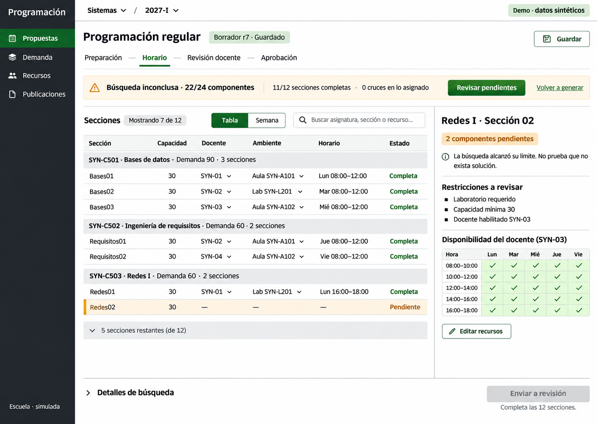
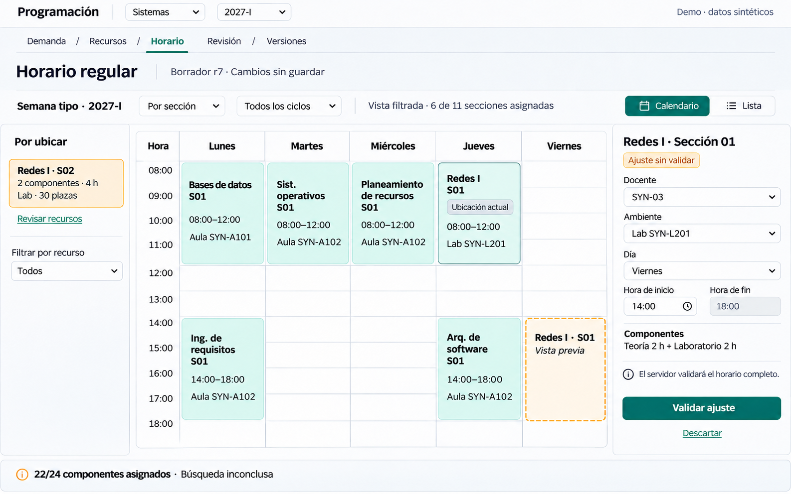
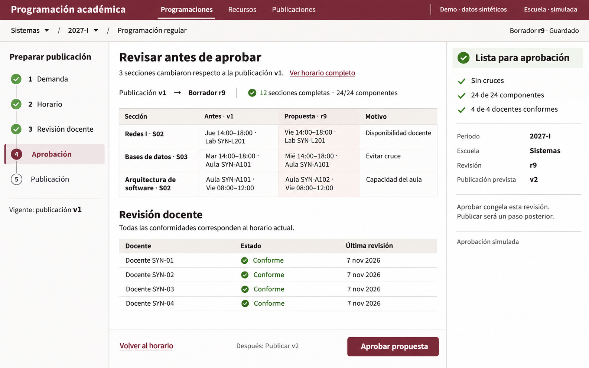

# Academic planning: three visual directions

Design exploration · 7 November 2026 · local-only proposals · no application implementation.

## Recommendation

Use **Operational Workbench** as the internal product's foundation. Its table-first workspace makes demand, section coverage, resources, and exceptions inspectable together. Adopt the Studio's calendar as another view of the same selection, and the Institutional Platform's approval dossier as the release stage. Apply one visual language across those task-specific patterns; do not combine three palettes or navigation systems.

The internal planning product and SUM student product have separate visual identities. SUM consumes an approved schedule through existing backend/shared contracts. This exploration changes no student screen, application source, contract, schema, dependency, runtime configuration, or repository design policy.

## Evidence and limits

| ID | Source | Classification and scope |
| --- | --- | --- |
| U1 | User's design brief in this conversation, 2026-11-07 | Authorizes a new internal visual identity and design artifacts only; student SUM remains protected. |
| P1 | Attached PDF, *Propuesta: programación académica y matrícula en tres etapas*, v1.0, 2026-10-29 | Product proposal. Sections 4.2–4.5 define intended workflows; 5–8 architecture, configuration and roles. Its references to regulations do not independently verify institutional enforcement. |
| R1 | [Root design policy](../../../DESIGN.md), [client design system](../../../client/DESIGN_SYSTEM.md), root/client AGENTS | Existing SUM identity and implementation boundaries. Per U1, these SUM visual tokens do not dictate the internal product's new identity. Policies were read, not changed. |
| C1 | [AcademicScheduling](../../../client/src/screens/AcademicScheduling.tsx), [data adapter](../../../client/src/data/academicScheduling.ts), [shared contract](../../../shared/programacion-academica-api.mjs) | Current code, read-only review on 2026-11-07. Implementation evidence, not production SUM evidence. |
| C2 | [Resource editor](../../../client/src/screens/AcademicResourceEditor.tsx), [teacher review](../../../client/src/screens/AcademicTeacherReview.tsx), [publication panel](../../../client/src/screens/AcademicPublicationPanel.tsx), [demand aggregation](../../../client/src/screens/AcademicIntentionDemandPanel.tsx) | Current local capabilities and limits. |
| C3 | [WeeklySchedule](../../../client/src/screens/WeeklySchedule.tsx), [RegularEnrollment](../../../client/src/screens/RegularEnrollment.tsx), [internal shell boundary](../../../client/src/components/AcademicLocalShell.tsx) | Reuse opportunities and student isolation boundaries. |
| E1 | [Current compact-editor record](../../../evidence/local/programacion-academica-manual/compact-verification.md), [earlier adjustment record](../../../evidence/local/programacion-academica-manual/fullstack-verification.md) and screenshots | Historical local synthetic observations, 2026-11-02. Inspected sections table, calendar, and split editor. Not a new live usability audit. |
| E2 | [Teacher review record](../../../evidence/local/programacion-academica-teacher-review/fullstack-verification.md) and review-approved.png | Historical synthetic observations, 2026-11-04; simulated roles. |
| E3 | [Publication record](../../../evidence/local/programacion-academica-publication/fullstack-verification.md) and phase-save-publication-panel.png | Historical synthetic observations, 2026-11-04; simulated approval/publication. |
| R2 | [Implementation status report](../../reverse-engineering/informe-avance-e1-e2-e3.md), 2026-11-05 | Reviewed against current code. Helpful summary; passing historical checks are not new validation. |

The supplied PDF remains an attachment; no copy of its potentially identifying content was added to the repository. Only synthetic/local reference material was inspected. No production session or private directory was accessed. There was no new live browser audit, accessibility test, or user study. Findings below are source-based design judgments supported by the dated screenshots.

## 1. Current experience

The current internal route is `/local/programacion-academica`. It has a separate wrapper, but its screen still uses SUM tokens, PageTitle, DataTable and the student-oriented weekly calendar. React local state orchestrates the proposal; validated adapters call the independent NestJS API. E1/E2 use local durable documents; the public PostgreSQL enrollment simulator is a separate deployment mode, not an already integrated internal staff platform.

The current operator sequence is: select courses and final demand/capacity → configure teachers and rooms → generate → inspect tables/calendar and diagnostics → adjust existing blocks → save → submit simulated teacher review → obtain current conformities → preview and approve → preview and publish. Approval freezes a proposal; editing a frozen version requires a new draft. Publishing does not activate E3 seats.

| UX limitation | Evidence | Consequence and design response |
| --- | --- | --- |
| Course cards repeat configuration for every course | C1; course grid styles | Comparing 20–32 courses requires scanning many separate forms. Use a demand table with disclosure for weekly patterns/history. |
| Review, publication and intention panels precede preparation/results in a long screen | C1 JSX | Operators must remember where they are in the process. Keep scope/state persistent and open a stage-specific workspace. |
| Table and calendar are vertically separated | E1; C1 | Relating a row to its placement requires scrolling and memory. Keep one selected section across table, week and inspector. |
| Schedule blocks repeat long course/resource/component prose | E1; C3 | Calendar text competes with temporal structure. Show course, section, time and resource; expose components in the inspector. |
| Draft revision, saved review, approval revision and publication number compete | C1/C2; E2/E3 | Operators can approve the wrong mental version. Distinguish `Borrador r9` from `Publicación v1` consistently and show exact transition effects. |
| Staff and teacher roles use a simulated selector | C2; E2 | Adequate for a demo, but not a permission model. Preserve a visible simulation label; propose role-specific surfaces only as future requirements. |
| Diagnostic codes and search statistics share priority with operational findings | C1 | Operators must translate technical output. Lead with affected sections and next useful action; retain raw diagnostics under Details. |
| Existing safeguards are useful but action availability is distributed | C1/C2 | Multiple disabled buttons and refresh steps obscure the next step. Explain the gate beside one primary action without weakening it. |

No task-duration improvement or accessibility compliance is claimed from these observations.

## 2. Concept A — Operational Workbench / Mesa de programación

**Principle:** work by exception, with the evidence beside the selected record.

A compact navigation rail establishes location; the proposal header preserves school, period, saved revision and stage. Most space belongs to a grouped sections table. A selected pending row opens a resource/constraint inspector. Table and week are two representations of the same proposal, not separate destinations that lose context.

The illustrated state is `search-limit`: 22 of 24 components assigned, 11 of 12 sections complete. “0 cruces en lo asignado” describes only assigned work. “Revisar pendientes” is the primary action; teacher review remains blocked. This must never be relabeled “impossible” merely because time ran out.

**Strengths:** direct course/resource comparison; predictable keyboard route; high useful density; good fit for current adapters and explicit manual editing. Filters can narrow pending, changed or selected records without destroying the proposal's global counts.

**Tradeoffs:** relationships across a week are less apparent. The right panel must be collapsible at narrower widths. A refinement moved course-level demand into group headers, retained capacity at section level, reduced repetition and explicitly shows seven of twelve sections. Do not imply section-level E2 intentions exist before registration. The generator still returned a taller canvas and one Redes I row with a two-hour summary; those are image limitations, not accepted duration semantics. The actual selected block and all required components must come from the validated proposal, with a multi-block disclosure when necessary.

Keep editable table cells as explicit entry points to the inspector; do not turn a dropdown change into an unvalidated server mutation.

## 3. Concept B — Visual Planning Studio / Taller de horarios

**Principle:** let operators reason spatially while keeping edits explicit and reversible.

Horizontal navigation and a small unassigned tray leave the calendar dominant. The right inspector edits the selected block's teacher, room, day and start. The original four-hour duration stays read-only. A current placement and a dashed proposed placement are visible together until the server accepts the adjustment.

The final image edits **assigned Redes I S01** from Thursday 08:00–12:00 to Friday 14:00–18:00. Unassigned S02 stays pending. “Validar ajuste” reuses the existing adjustment intent; it does not create assignments for missing components. Dragging, if later implemented, would only populate the same preview form. A pointer-free day/time form remains available.

**Strengths:** best spatial feedback; clear before/after placement; immediate relation between resource, duration and selected section. Well suited to focused manual correction.

**Tradeoffs:** concurrent sections need lanes or filters; one cell cannot safely represent the whole school. The image shows six of eleven assigned sections; the applied subset must be explicit in real controls. A Monday–Friday frame is only this synthetic scenario: actual availability can include Saturday and Sunday, which must remain accessible. Narrow screens need a day agenda and list, not a scaled-down five-column grid. The “Todos”/“vista filtrada” combination in the image still needs a precise applied-filter label in a future design pass.

**Refinement performed:** removed fabricated conformity/lock labels and an extra concept title; corrected two-hour-looking blocks to four-hour blocks; changed the preview from unsupported placement of an unassigned section to editing an existing assigned block. Earlier Studio renders are superseded by this saved image.

## 4. Concept C — Modern Institutional Platform / Expediente académico

**Principle:** present an accountable decision, its evidence and its consequence together.

A process outline replaces a generic dashboard. The central document compares the draft against a published baseline; a narrow readiness column establishes why approval is available. The sole primary decision is “Aprobar propuesta”. Publishing is explicitly subsequent.

The synthetic proposal has reached r9, all 24 components are assigned and all four teacher conformities are current. Three changed sections are reviewed against publication v1. Publication v2 is an expectation, not a committed identifier. In a real concurrent workflow the server's current publication must still be checked.

**Strengths:** strongest occasional-user discoverability; clear separation of editing, approval and publication; good fit for director review and version history.

**Tradeoffs:** slower for repeated row-level editing; process navigation should not force operators through completed stages for every small adjustment. The image repeats readiness counts in two places and uses more green checks than necessary. Retain one readiness summary and expose detailed evidence on demand. Changed teacher decisions must invalidate readiness immediately, not leave green indicators stale.

**Capability boundary:** current code supplies versioned snapshots and approval gates, but does not supply this semantic before/after diff or authored change reasons. A future diff needs stable entity matching and an explicit baseline. Do not invent a “Motivo” from a changed value; show a recorded reason when available, otherwise “Sin motivo registrado”. This image is an intended interaction, not proof that a diff/audit feature exists.

## 5. Comparative evaluation

These are expert forecasts, not measured usability scores. The images deliberately show different stages; they are not controlled A/B tests of identical tasks. No numerical score or completion percentage is fabricated.

| Criterion | A: Workbench | B: Studio | C: Institutional |
| --- | --- | --- | --- |
| Task efficiency | Best for many records and exceptions | Best for placement corrections | Best for a bounded approval decision |
| Primary-action discovery | Clear next action; requires learning row/inspector relationship | Strong selected-block action; tray can compete | Strongest single decision and consequence |
| Information hierarchy | Context → status → records → inspector | Context → time grid → edit form | Stage → changes → evidence → approval |
| Dense academic data | Strong; numeric alignment and grouping | Weak without resource/cycle filtering | Moderate; summarizes rather than edits |
| Timetable readability | Secondary week view needed | Strongest at a filtered resource/section scale | Inspection link; not an editing canvas |
| Constraints and conflicts | Strong affected-row + inspector association | Strong spatial conflicts; non-time constraints need inspector | Shows readiness, but sends repair elsewhere |
| Cognitive load | Moderate for novices; low after learning | Low for one placement, high for whole-school overlaps | Low for reviewers; extra navigation for planners |
| Accessibility | Semantic table and form offer a solid starting point | Needs equivalent list/form and non-drag operation | Document order maps well to reading/keyboard order |
| Responsiveness | Collapsible inspector + readable table region | Hardest; needs day/agenda mode | Easiest; stack readiness and change records |
| React/CSS feasibility | Closest to existing tables, adapters and edit semantics | Most work: overlap layout, grid and focus model | Moderate layout work; real diff semantics need definition |
| PDF consistency | Covers operational generation/repair and handoffs | Covers timetable review; cannot replace demand/approval workflows | Covers human approval, versioning and separate publication |
| Extension across internal system | Strong base for demand/resources/queues | Best as a specialized mode | Strong for reviews, publication and administrative decisions |

**Recommendation:** A provides the broadest daily operating surface with the fewest hidden assumptions. Use B's week view and C's decision dossier inside A's navigation and tokens. Do not apply the workbench table pattern to every task: teacher decisions deserve a focused queue and approval deserves a document view.

## 6. Proposed information architecture

These are proposed views, not existing routes. Keep the internal application under its existing local module boundary; do not add these destinations to the SUM student menu.

| Primary destination | Main work views | Best interaction pattern |
| --- | --- | --- |
| Programaciones | Proposal index, preparation, sections/week, exceptions, change review | Dense searchable list; one proposal workspace with persistent scope and selection |
| Demanda | Potential eligibility, uncertainty, historical rates when available, final planning demand | Course table with source/cutoff and detail disclosure; keep potential, E2 intention and operator demand separate |
| Recursos | Teachers, qualifications, workload, availability; rooms/labs, capacity and availability | Master list + focused resource form and recurring availability grid |
| Revisión docente | School response queue, teacher's own schedule, observations and round history | Status-filtered queue for school; one-decision schedule view for teacher |
| Publicaciones | Approval dossier, publication preview, immutable versions, create draft from version | Read-only release document and version timeline |

**Demand-based adjustment is a contextual entry from a published version**, not another generic dashboard. Compare intended demand and planned capacity by course/section; propose open-section, expand-classroom, or keep-lab-capacity actions only when S-5 contracts exist. Preserve the baseline and show affected sections before approval. Reuse the same generation/review/release workspaces for the resulting draft.

For the eventual teacher surface, show only the teacher's own assignments and allowed observations. Do not expose peers' preferences. A simulation role selector cannot establish these permissions.

**Conflict resolution** lives in the proposal's exception queue. Each record links an affected section/component, the supported constraint, the relevant resource and an explicit correction form. Separate hard violations from unmet preferences and search-limit uncertainty. Teacher objections link to that queue, but they remain observations until a human-approved constraint operation exists. Never label a proposed alternative as feasible before server validation, or reveal another teacher's confidential preference to explain a conflict.

### Lifecycle and realistic states

| State | Immediately visible | Next action / safeguard |
| --- | --- | --- |
| Catalog loading/error | Scoped loading text, then retryable failure distinct from empty | Retry; never substitute mock success after API failure |
| No courses selected | Empty course table with scope and configuration entry | Select courses; do not equate empty generation with ready for review |
| Unsaved draft | `Cambios sin guardar` beside exact saved revision | Save before review; scope switch must resolve unsaved edits |
| Generating | Busy label and preserved input scope | Block duplicate submissions; no fabricated percent-complete or cancellable server job |
| Complete proposal | Required component coverage and valid assignments | Save, then send to teacher review |
| Search limit / partial | Assigned/pending counts and `Búsqueda inconclusa` | Inspect resources/constraints or regenerate; never claim infeasibility |
| Proven impossible in configured domain | Specific supported diagnosis and affected components | Edit relevant inputs; avoid diagnosing a missing teacher from pending count alone |
| Manual adjustment preview | Current vs proposed location, preserved duration, unsaved/invalidated state | Validate through existing API; a rejected adjustment preserves committed schedule |
| Teacher responses pending | Pending, observed, outdated, conforming as text; round and snapshot | Review each response; no approval until existing gates pass |
| All conformities current | Exact proposal revision and complete coverage | Fresh approval preview; never derive authorization from the client role selector |
| Approved, unpublished | `Aprobada · sin publicar`, frozen snapshot | Separate publication preview and confirmation |
| Published | Exact publication ID/version; read-only state | Create a new draft for changes; old version remains intact |
| Stale revision / CAS conflict | Server changed, local draft preserved | Reload/reconcile explicitly; no silent overwrite or optimistic success |

Current teacher rounds persist, but timed deadlines, three-round escalation, automatic objection-to-constraint processing and LangGraph agents remain PDF requirements for future work. Do not display active timers, automatic escalation or AI-generated resolutions in a reskin of today's prototype.

## 7. Preliminary internal design system

All tokens below are **new design proposals**, not changes to SUM policies or measured production values.

| Area | Proposed direction |
| --- | --- |
| Typography | IBM Plex Sans or a comparable readable sans; verify local font availability/licensing before adding. Body/table 14px, form 14–16px, labels 13px, section title 18px, page title 24px. Avoid essential text below 12px. Tabular numerals; mono only for technical IDs. |
| Color | Canvas #F5F6F5; surface #FFFFFF; text #202925; muted #52625A; rail #202A25; primary #175C3B; selected #EAF2ED; border #D7DED9. Warning text #805300 on #FFF4DC; error #A12622 on #FDECEB. These are candidate values; verify contrast in actual rendered states. |
| Spacing | 4px base, 8/12/16/24/32px steps. 24px workspace gutters; 16px inspector padding; 40–44px default rows/controls, optional 36px dense rows with adequate separate hit areas. 44px touch targets. |
| Surfaces | Continuous working surface, light row separators, square-to-4px control corners; 8px max for floating surfaces. Borders for structure, shadow only for overlays. No nested card grid. |
| Navigation | Compact product rail, persistent school/period/proposal context, stage navigation inside a proposal. Scope and stage are different controls. Preserve filters, selection and scroll when switching table/week. |
| Components | Semantic data table; row inspector; recurring availability grid; weekly timetable + list; diagnostic queue; change table; teacher decision form; immutable release preview. Reuse logic before introducing visual replacements. |
| States | Default/hover/selected/focus/disabled/busy/error all specified. Solid primary for the next valid transition, secondary for save/back, text actions for inspection. Disabled gates have nearby reason text. |
| Motion | Short 120–160ms panel transitions where useful; respect reduced motion. No glows, perpetual shimmer or animated success decoration. |

### Accessibility and responsive behavior

- Target WCAG 2.2 AA, subject to implementation testing. Text 4.5:1; meaningful controls/focus boundaries 3:1. Never convey conformity, conflict, changed or published solely through color.
- Keep standard table keyboard semantics for a read-only table. Do not assign `role=grid` unless a complete, tested grid keyboard interaction is deliberately implemented. Use labelled row actions to enter the inspector.
- Every calendar item has an accessible name containing course, section, day/time and resource. Offer a list and explicit edit form. Dragging is optional; keyboard and touch need an equally complete path.
- Dialogs/drawers manage focus, support Escape where safe and return focus to the triggering row. Validation connects field errors and a summary; status changes announce once without moving focus.
- At 1440px: about176px rail; flexible table/calendar; optional300–340px inspector. At 1024px: inspector becomes an overlay sheet. Below768px: stage header + list/day agenda, with full form detail. These are hypotheses, not verified breakpoints.
- At 200% zoom, retain scope, primary action and access to full data. A table can scroll in a labelled region; never shrink its text to avoid overflow. Weekend availability and late hours remain accessible when configured.
- A recurring academic timetable has no misleading “today” indicator. Keep source/cutoff dates in demand detail; keep period and revision visible throughout.

## 8. Repository-compatible implementation sequence (future)

No phase below was started by this exploration. Preserve SUM visual/interaction fidelity in every future handoff; only internal planning views may change. Reuse existing interfaces and contracts unless an incompatibility and migration are explicitly recorded.

1. **Select and refine the internal target.** Confirm Workbench direction and correct the image's demand-column semantics, row count, title scale and narrow layout. Define three synthetic benchmark tasks: resolve a pending section, adjust an existing block, approve then publish an exact revision. Observe actual operators before claiming a productivity improvement.
2. **Isolate internal styling and route shell.** Reuse AcademicLocalShell's existing boundary and TanStack Router. Scope future `--planning-*` tokens to the internal root. Do not change global `--sum-*`, font/reset rules, student Common components or student navigation. Review shared CSS blast radius before editing any primitive.
3. **Restructure the current workspace around existing operations.** Preserve `academicScheduling.ts`, shared validators, expected-version checks, stale-response protection and explicit save. Move presentational sections into stage views without altering API effects. Initially show only the supported Sistemas/2027-I scope; enable another scope only when its data/contract exists. Maintain current generator limits.
4. **Add table/inspector and calendar representations.** Reuse `aggregateAcademicBlocks`, `academicSectionCoverage`, formatting helpers and display projections. Reuse existing adjustment request semantics. Inspect DataTable for semantic reuse; because its CSS serves student screens, a scoped internal rendering layer may be necessary. Record that visual incompatibility before introducing a replacement. Keep shared student WeeklySchedule intact; reuse transformations in a planning-specific view rather than restyling the student calendar globally.
5. **Reorganize current resource and demand forms.** Preserve qualification, availability, capacity, source uncertainty and potential/intention/final-demand distinctions. A visual cleanup must not hardcode new academic rules or quietly turn potential into enrolled demand.
6. **Present current review and release gates clearly.** Reuse current responses, fingerprints, round history, release previews and immutable publications. Keep simulated permissions visible. Define the diff baseline and unavailable change reasons before implementing C's comparison view. Do not add unsupported audit claims.
7. **Specify functional gaps separately.** Real role authorization, teacher portal isolation, deadlines/three-round escalation, S-5 suggestions/notifications, configurable new scopes, and production-scale persistence are independent requirements with contracts and acceptance criteria. Design can reserve their place without rendering them as working features.
8. **Verify after implementation is authorized.** Affected client build/lint and data tests; actual synthetic React→NestJS scenarios for generation, partial/impossible results, rejected adjustment, CAS conflict, review invalidation, separate approval/publication and immutable history. Add keyboard/zoom/responsive checks and student screen regressions at equivalent viewport/content/state. Current build/lint alone would not verify this design.

## Artifact and acceptance record

- Built-in image generation produced three independent directions. Workbench received one refinement; Studio received two corrections within the same direction. No fallback API/CLI was used. The tool did not expose a model selector or model identifier; Image 2.6 is unverified.
- Functional reference screenshots were actually passed to generation calls. They grounded operations, not the new internal visual identity. New mock data uses SYN course/resource IDs and no real student or teacher identities.
- Target design viewport: 1440×900. Native generated rasters: A 1487×1058; B/C 1586×992. They are not exact viewport captures; the review board preserves aspect ratios without stretching. A needs recomposition for a strict 1440×900 implementation target. No pixel-level claim is made.
- Exact prompts and reference lists: [prompts.json](prompts.json), [Workbench refinement](workbench-refinement.txt), and the final [Studio functional correction](studio-functional-refinement.txt). Saved final PNGs are in [images/](images/).
- Presentation-only review board: [review-board.html](review-board.html). It presents image concepts and critique; it is not application UI or an interactive product prototype.
- Deterministic document checks: required deliverable sections, relative links/assets, JSON syntax, three image signatures/dimensions and artifact-only Git scope. Application tests were not run for this design-only task.

| Acceptance criterion | Check | Result |
| --- | --- | --- |
| All eight requested deliverables | Required report sections and comparison criteria reviewed | Passed |
| Three independent concepts | Three final PNGs decode and match declared native dimensions | Passed; no exact-viewport claim |
| Traceable briefs and references | JSON parses; refinement files and source links resolve | Passed |
| Usable presentation artifact | Three tab/panel pairs and image paths checked; extracted JavaScript passes `node --check` | Passed syntax/structure; interactive browser behavior unverified |
| Visual presentation in chat | T3 `html_preview`, then `html_render` | Preview blocked by host AppArmor; inline rendering succeeded |
| No implementation or policy changes | Git tracked diff empty; new work confined to this design directory | Passed; two pre-existing untracked reverse-engineering plans preserved |
| Document hygiene | Relative-link/assets check, trailing-whitespace check, `git diff --check` | Passed |

The next design decision is whether Workbench should become the base direction, with the Studio and approval dossier treated as specialized views in that system.
