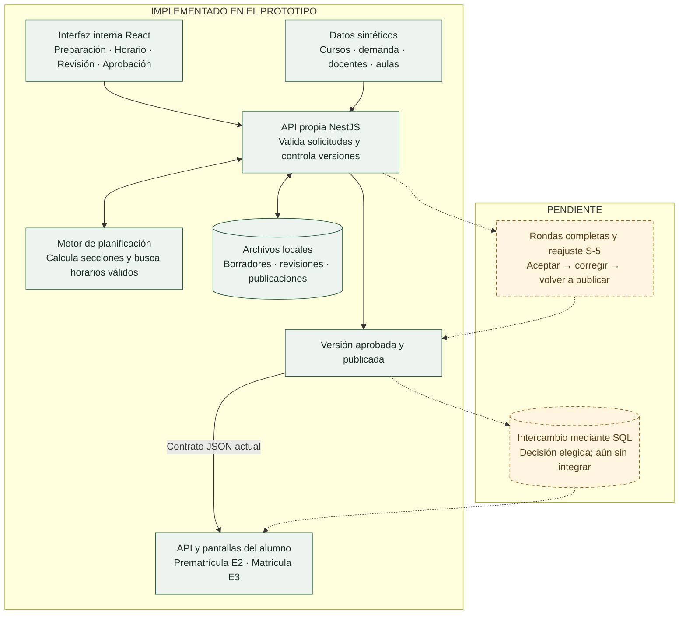

# Qué hace el sistema y cómo trabajar con 96 cursos

Fecha: 2026-11-07. Diagnóstico de código sobre `feat/planning-program`, commit `f492a8f`. No se modificó la aplicación ni se recorrió el navegador en este análisis.

La dirección [A/B/C elegida](../design-direction.md) permanece vinculante. El problema encontrado es de organización del trabajo, no una nueva decisión de identidad visual.

## Arquitectura lógica actual y pendiente

Fuente editable: [academic-planning-architecture.mmd](academic-planning-architecture.mmd).

Las líneas continuas representan capacidades presentes; las discontinuas representan trabajo pendiente. El esquema es lógico, no un diagrama de despliegue: hoy el código de ambos productos comparte el backend NestJS, y la entrada `local-main.ts` del demo visible inicia únicamente el módulo interno de planificación. El demo de programación no equivale a tener desplegado allí el recorrido estudiantil completo.

La publicación actual la consulta PrematriculaService mediante SavedDraftService y la expone como JSON a su cliente. No existe todavía el intercambio SQL elegido por el usuario. PostgreSQL ya existe en el simulador de matrícula, que es otra configuración; su existencia no significa que planificación publique en SQL.

## Qué se está haciendo realmente

- Motor: dimensionar secciones con demanda/capacidad, asignar docentes/aulas/franjas y validar restricciones. La búsqueda es acotada: un resultado parcial por límite no demuestra que no exista solución.
- Operación: permitir ajustes de bloques existentes, guardado y recuperación de propuestas.
- Revisión: conservar respuestas docentes y versiones; extenderlo a rondas completas es trabajo pendiente.
- Publicación: aprobar y publicar como operaciones distintas; mantener versiones consultables.
- Interfaz: se añadieron encabezado/etapas y tabla agrupada con inspector. Preparación aún conserva un formulario por curso.
- Integración futura: intercambio SQL y reajuste S-5. No presentarlos como terminados.

El objetivo operativo es que la escuela prepare la oferta del periodo, el motor proponga una programación y las personas resuelvan excepciones, revisen y publiquen. No se pretende que una persona construya a mano cada bloque de 96 cursos.

## Hallazgo sobre 96 cursos

`PLANNING_LIMITS.courses = 96` es un límite de entrada de la propuesta. No prueba que el catálogo actual tenga exactamente 96 cursos, que el operador pueda trabajar cómodamente con ellos, ni que el generador encuentre un horario completo dentro de su presupuesto para todos los casos.

La etapa Preparación calcula `visibleCourses` con un filtro por ciclo y dibuja un `article.academic-scheduling__course` por curso. Cada artículo contiene selección, demanda, capacidad, patrón semanal, modalidad y referencia histórica. El resultado sigue siendo una colección de formularios. Aumentar el límite a 96 no resuelve esa carga cognitiva.

Además, algunos contratos del estimador todavía limitan sus listas a 32, mientras la solicitud de generación admite 96. Debe revisarse y probarse esa consistencia antes de presentar el flujo completo de demanda de 96 cursos como soportado.

## Organización propuesta para una oferta grande

Esta es una propuesta funcional/UX, no una implementación ni una afirmación sobre SUM oficial.

1. Elegir escuela, periodo y plan. Mostrar qué datos están disponibles, su corte y qué falta.
2. Partir de una oferta borrador del periodo basada en el catálogo y reglas configuradas. El sistema puede proponer inclusiones cuando hay una base explícita; la escuela las confirma. No inferir por la paridad del ciclo que un curso necesariamente se ofrece.
3. Mostrar una tabla con una fila por curso: código/nombre, ciclo, demanda final, capacidad objetivo, secciones previstas y estado de configuración. Preparación no abre todos los campos.
4. Permitir búsqueda, agrupación por ciclo, selección múltiple y cambios en lote con vista previa. Editar patrones/recursos en un inspector de un curso o recurso a la vez.
5. Abrir de forma prioritaria los cursos que requieren decisión: información faltante, capacidad incompatible o asignación pendiente. No inventar una prioridad de incidencias que el motor no pueda justificar.
6. Generar sobre el conjunto seleccionado completo. El filtro visual por ciclo no excluye cursos ni elimina conflictos entre docentes y aulas compartidos.
7. Revisar resultados por excepción: primero pendientes y restricciones, después una sección concreta en Tabla o Semana. Identificar siempre el subconjunto visible y los totales de la propuesta.
8. Revisión docente y aprobación/publicación tienen su propia tarea, sin volver a abrir 96 formularios.

Curso, sección y componente no son equivalentes. Un curso puede producir varias secciones; una sección puede requerir varios componentes. Los totales y la vista Semana deben conservar esa distinción.

## Criterios de aceptación sugeridos antes de seguir ampliando la interfaz

- Con 96 cursos sintéticos, la preparación inicial no muestra 96 formularios expandidos; conserva una fila compacta por curso y un solo inspector activo.
- El operador encuentra un curso por nombre/código y un ciclo concreto sin recorrer el catálogo completo.
- Siempre se distinguen catálogo, cursos incluidos, filas visibles y secciones/componentes generados.
- Cambiar filtros no cambia silenciosamente la selección ni la entrada que recibe el motor.
- Los cambios en lote muestran alcance, exclusiones y efecto antes de aplicarse.
- Un recurso compartido entre ciclos sigue impidiendo cruces aunque esos ciclos no estén visibles juntos.
- Se prueban por separado: tamaño aceptado por contrato, respuesta del estimador, comportamiento del generador, lectura/teclado/zoom y éxito del operador. No sustituir estas pruebas por el número máximo de entrada.
- No se inventa un tiempo máximo de generación ni se promete una solución completa para 96 cursos sin medir escenarios realistas y los límites de búsqueda.
- Mantener el diseño interno elegido y preservar pantallas/componentes/tokens estudiantiles.

## Evidencia revisada

| Fuente | Qué acredita |
| --- | --- |
| [AcademicScheduling.tsx](../../client/src/screens/AcademicScheduling.tsx) | Etapas actuales, selección y `visibleCourses.map` que genera los formularios |
| [academic-planning-policy.mjs](../../shared/academic-planning-policy.mjs) | Límite de 96 cursos, 128 docentes/ambientes y 1024 sesiones |
| [programacion-academica-api.mjs](../../shared/programacion-academica-api.mjs) | Contratos de solicitud de generación y límites propios de estimación |
| [demo-proposal.service.ts](../../backend/src/programacion-academica/demo-proposal.service.ts) | Demanda, generación, ajustes y retención de propuestas |
| [saved-draft-store.ts](../../backend/src/programacion-academica/saved-draft-store.ts) | Persistencia local por archivos, no publicación SQL |
| [prematricula.service.ts](../../backend/src/prematricula/prematricula.service.ts) | Consulta actual de publicaciones |
| [local-main.ts](../../backend/src/programacion-academica/local-main.ts) | Arranque del demo interno y restricción contra snapshots |
| [Programa vigente](../reverse-engineering/plans/planning-product-program.md) | Estado integrado y trabajo pendiente; no sustituye validación de ejecución |

Clasificación: observación estática del prototipo propio y propuesta UX `local-only`. No es auditoría visual en vivo ni evidencia de producción SUM. Se verificaron enlaces y presencia del Mermaid; no se ejecutaron pruebas de aplicación.
