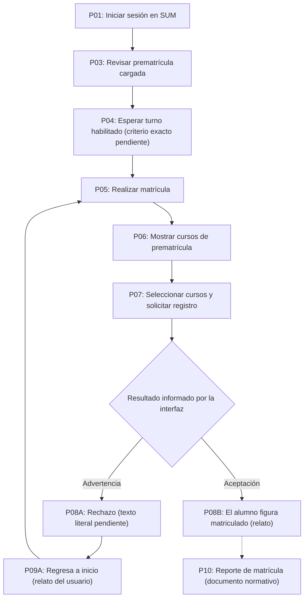

# as-is-process.md — matrícula regular FISI/UNMSM, 2026-II

**Corte documental:** 11-10-2026. **Alcance principal:** matrícula regular por Internet, estudiantes de Ingeniería de Sistemas e Ingeniería de Software de FISI. **Naturaleza:** reconstrucción limitada del proceso AS-IS, **no prueba concluyente de los controles internos del SUM**. Otras modalidades se conservan como dependencias o pendientes.

## Leyenda y jerarquía de evidencia

- **[Verificado-norma]**: obligación, definición o fecha sustentada en normativa 2026 o cronograma rectoral; no garantiza que sea una pantalla o bloqueo.
- **[Verificado-FISI]**: contenido explícito de comunicado o documento FISI sobre 2026-II, con URL institucional y alcance definido.
- **[Observado-testimonio]**: secuencia que el usuario describió a partir de su experiencia en SUM; sin captura autenticada o secuencia repetible adjunta.
- **[Inferido]**: elaboración del analista, no debe pasar a `specify` como verdad.
- **[Por confirmar]**: desconocido; requiere evidencia primaria reproducible o aclaración con SUM/FISI.

Fuentes identificadas en `business-rules.md`. Enlaces canónicos: [Reglamento vigente, R.R. 002642-2026-R, 26-02-2026](https://sum.unmsm.edu.pe/assets/ReglamentoCompleto/reglamento2026.pdf) (**F1**), [cronograma 2026, anexo R.R. 014408-2025-R, 16-12-2025](https://sum2.unmsm.edu.pe/assets/cronograma/ANEXO_RR-014408-2025-R.pdf) (**F2**), [comunicado FISI 2026-2 de vacantes/regularización](https://sistemas.unmsm.edu.pe/site/slider/1854-comunicado-urgente-regularizacion-de-matricula-y-casos-pendientes-para-el-periodo-academico-2026-2) (**F3**); [cuadro oficial de turnos FISI 2026-II](https://sistemas.unmsm.edu.pe/site/images/2.-_Cuadro_Intervalo_de_horario_con_Promedios_Ponderados_para_Semestre_2026-II_F_.pdf) (**F6**).

## Actores, responsabilidad y límites

| Actor / ámbito | Responsabilidad sustentada | Evidencia / limitación |
|---|---|---|
| Estudiante FISI | Ejecuta su matrícula vía Internet; gestiona reportes y elección de asignaturas. | [Verificado-norma] F1, arts. 10 y 25. |
| SUM / OSUM | Aplicativo institucional y procesamiento del cronograma; mantiene información de matrícula y provee reportes y rankings. | [Verificado-norma] F1, arts. 8, 13.q–v, 14–17, 25. Orden real de validadores y persistencia desconocidos. |
| Vicedecano Académico / Vicedecanato FISI | Responsable funcional; autorizaciones formales de rectificación y casos particulares; visado documental de reporte conforme art. 25. | [Verificado-norma] F1, arts. 6, 13.b–e, 25–29. **No** consta aprobación manual previa a que el SUM registre cada matrícula regular virtual. |
| Unidad de Matrícula, Registro Académico, Grados y Títulos FISI | Operación técnico-administrativa y matrícula presencial; casos de regularización. | [Verificado-norma] F1, arts. 7 y 25; [Verificado-FISI] F3. |
| Decano | Autoridad académico-administrativa; emite resoluciones en los casos expresamente establecidos (p. ej., tutoría, reserva, anulación). | [Verificado-norma] F1, arts. 6, 13.c, 13.e, 13.h. **No** interviene como aprobador de cada matrícula regular en Internet. |
| Director de Escuela Profesional | Programa y suministra información académica; opinión en reserva y gestión de tutorías. | [Verificado-norma] F1, arts. 13.h, 13.o, 15. |
| Consejero de matrícula | Visa el reporte de **prematrícula presencial**, no necesariamente virtual. | [Verificado-norma] F1, art. 25, sección «Matrícula presencial». |
| «Tutor de Matrícula» como autoridad que visa matrícula | Denominación y rol no documentados para matrícula regular virtual; no confundir con **tutoría obligatoria** por repitencia. | [Por confirmar]: eliminar como actor genérico. |

## Fechas académicas 2026-II — régimen semestral

Las fechas generales de la siguiente tabla se sustentan en **[Verificado-norma]** F2, anexo R.R. 014408-2025-R, página 2, 16-12-2025; el desglose FISI del renglón de matrícula regular se sustenta en **[Verificado-FISI]** F6. **No** corresponden a cronogramas de Ciencias Sociales ni posgrado.

| Hito | Fecha oficial 2026 | Advertencia de alcance |
|---|---|---|
| Programación de asignaturas 2026-II | 30-07 a 07-08 | Es programación institucional, no momento de elección de cursos por el estudiante. |
| Reactualización y reserva | **Hasta 03-08** | Límite de envío al SUM de **resolución decanal**. La facultad puede fijar cierre de solicitudes **anterior**. No se encontró plazo interno FISI. |
| Prematrícula / cursos habilitados | **Miércoles 05 y viernes 07-08** | Existencia de reporte prevista por F1 art. 13.r; falta confirmar detalle de habilitación UI. |
| Matrícula regular | **10 a 14-08** | F2 fija el rango general; **F6** desarrolla el cronograma local FISI: 10 virtual por PP, 11–12 virtual libre y 13–14 presencial para casos específicos. **No** significa que los cinco días operen virtualmente para todos. |
| Rectificación / matrícula extemporánea | **07 a 11-09** | No confundir con «rezagados» de exámenes. |
| Inicio de clases | **24-08** | — |
| Rectificación por casos especiales con Consejo de Facultad | **19 a 23-10** | No es reabrir matrícula regular indiscriminadamente. |
| Anulación de matrícula | **28 y 29-10** | Ver discrepancia de un día frente a F1 art. 13.e: 45 días antes de 12-12. |
| Fin de clases | **12-12** | — |
| Sustitutorios / Rezagados | **14 a 16-12** | Se refiere a **evaluaciones**, no evidencia de una fase de **matrícula de rezagados**. |

## Turnos concretos de FISI 2026-II [Verificado-FISI], sin extrapolación

**Fuente F6:** [PDF institucional FISI](https://sistemas.unmsm.edu.pe/site/images/2.-_Cuadro_Intervalo_de_horario_con_Promedios_Ponderados_para_Semestre_2026-II_F_.pdf); firma del 21-07-2026 visible en captura aportada el 11-10-2026. La tabla se transcribe también en `business-rules.md` y **solo tiene vigencia para FISI 2026-II**:

| Lunes 10: franja virtual por ponderado | PP desde–hasta |
|---|---|
| 06:00–08:00 | 17.00–19.00 |
| 08:00–10:00 | 16.00–19.00 |
| 10:00–12:00 | 15.00–19.00 |
| 12:00–14:00 | 14.00–19.00 |
| 14:00–16:00 | 13.00–19.00 |
| 16:00–18:00 | 12.00–19.00 |
| 18:00–20:00 | 11.00–19.00 |
| 20:00–22:00 | 10.00–19.00 |
| 22:00–23:59 | 00.00–19.00 |

- **Martes 11 y miércoles 12:** modalidad **virtual «libre»** según F6, sin horas operativas ni aclaración sobre tipos de alumno elegibles; **no inferir 00:00–23:59**.
- **Jueves 13:** modalidad **presencial**, alumnos observados de 2.ª y 3.ª repitencia **con resolución de tutoría**, 08:00–13:00 y 14:00–16:00.
- **Viernes 14:** modalidad **presencial**, alumnos que presentaron problemas al matricularse, 08:00–13:00 y 14:00–16:00.
- **Lectura prudente:** los rangos de PP se solapan y tienen umbral descendente; **no** se ha corroborado que el SUM permita registrarse durante todas las franjas posteriores, cómo maneja PP >19.00 ni cómo corta la sesión al cambiar de día. El PDF presenta repetición de «grupo» 6/7 en las dos últimas filas (ver transcripción literal en `business-rules.md`).
- **Configuración futura:** este es un perfil local fechado de FISI, subordinado al calendario general F2. Los cortes, horas y modalidades cambian por periodo; no codificar `2026-II` ni estos puntajes como política global.

## Rebanada 1 — matrícula regular por Internet, secuencia provisional

**Nota importante:** los pasos P03–P10 relativos a **interacción de interfaz** proceden del relato aportado por el usuario; **no hay trazas ni imágenes de la sesión de matrícula**. Sí existe F6, un cuadro FISI documental de turnos, pero **no** es captura de la UI. Por ello se conservan como testimonio, no como observación instrumentada. P11–P12 son obligaciones documentales separadas y **no se incorporan como puertas de éxito de la UI**.

| Paso | Acción / transición | Etiqueta | Resultado observable o duda | Referencia |
|---|---|---|---|---|
| P01 | El estudiante accede al SUM con su cuenta. | [Observado-testimonio] | Inicio de sesión y contexto del estudiante; caducidad desconocida. | Relato usuario, 11-10-2026; F1, art. 25 (canal Internet). |
| P02 | Existe un reporte de prematrícula en SUM que refleja asignaturas pendientes del plan. | [Verificado-norma] | No se afirma que sea todo el catálogo ofertado ni que la descarga habilite una función. | F1, art. 13.r. |
| P03 | El estudiante comprueba que los cursos de prematrícula están correctamente cargados. | [Observado-testimonio] | «Correctamente cargados» no tiene criterio institucional documentado. | Relato usuario, 11-10-2026. |
| P04 | Consulta el turno FISI correspondiente al periodo y espera habilitación, **si está en el lunes 10 de agosto de 2026** según su PP. Para el 11–12 la publicación señala «libre». | [Verificado-FISI] para cronograma; [Observado-testimonio] para espera y efecto en la UI | F6 publica cortes y horas del lunes; falta observar habilitación real de «Realizar matrícula», y precisar a quién se aplica «libre». | F6, cuadro firmado 21-07-2026; relato del usuario. |
| P05 | Durante el turno, pulsa **«Realizar matrícula»**. | [Observado-testimonio] | Literal del control reportado por usuario, **pendiente captura**. No extrapolar disponibilidad fuera del turno. | Relato usuario. |
| P06 | La pantalla siguiente presenta cursos procedentes de prematrícula y permite elegirlos/secciones. | [Observado-testimonio] | No se sabe si cursos faltantes, llenos o sin prerrequisitos se ocultan. | Relato usuario. |
| P07 | El estudiante selecciona la carga y solicita concretar la matrícula. | [Observado-testimonio] | No se conoce el literal del botón final, ni si se hacen validaciones intermedias. | Relato usuario. |
| P08A | Si al intentar completar existen errores como cruce o sección llena, se muestra **una advertencia** y no culmina la matrícula solicitada. | [Observado-testimonio] | El usuario menciona esas dos causas; orden, cardinalidad y **texto exacto pendientes**. F3 documenta requisito de cupos; F1 trata cruce en rectificación. | Relato usuario; F3, «Disponibilidad de cupos»; F1, art. 13.d(i). |
| P09A | Después del rechazo, el usuario **reporta** que vuelve a la página principal y debe entrar otra vez por **«Realizar matrícula»**. | [Observado-testimonio] | No afirmar que la selección anterior siempre se borra ni que es igual para todos los errores. | Relato usuario. |
| P08B | Si la operación es aceptada, el usuario **reporta** que ya figura matriculado en SUM. | [Observado-testimonio] | Pendiente definir indicador visual, documento final y confirmación de persistencia. | Relato usuario; F1, arts. 13.s y 25. |
| P10 | Se obtiene/revisa el reporte de matrícula que representa las asignaturas del periodo. | [Verificado-norma] para existencia; [Por confirmar] para disponibilidad inmediata | No imponer descarga ni impresión como transición que cambie el estado de matrícula. | F1, arts. 13.s, 25.c. |
| P11 | Descargar reporte de prematrícula, según las instrucciones normativas para matrícula por Internet. | [Verificado-norma] | **No se ha observado bloqueo del SUM por no descargar**; no modelar como validación técnica. | F1, art. 25.a; relato usuario en sentido técnico contrario. |
| P12 | Imprimir el reporte de matrícula para visado del Vicedecanato, como documento de respaldo ante reclamos. | [Verificado-norma] | **No hay evidencia de que este paso sea necesario para pasar a «matriculado» en SUM**. | F1, art. 25.d; relato usuario. |

### Diagrama del recorrido reportado (no del motor interno)

**Separación documental:** el paso P11 (descargar prematrícula) está previsto en la norma, pero no se coloca antes de `D` como guardia técnica. El paso P12 (impresión/visado) está previsto en la norma, pero **no** se coloca entre `G` y `J` como requisito para registrar la matrícula. Esta decisión describe la **incertidumbre observacional**, no elimina obligaciones administrativas.

## Validaciones — qué está demostrado y qué no

| Tema | Base normativa / FISI | Comportamiento de UI disponible | Incertidumbre para emular |
|---|---|---|---|
| Créditos | F1, art. 13.p; F3 mínimos y autorizaciones | Ningún mensaje capturado | ¿En cada selección o al confirmar? ¿excepciones aplicadas automáticamente? |
| Prerrequisitos | F1, arts. 13.a, 18 | No hay recorrido reproducible | ¿Filtra elegibles o genera warning al confirmar? |
| Horarios | F1, art. 13.d(i) expresa para rectificación | Relato de advertencia en matrícula regular | ¿Bloquea adición o confirmación, cuántos conflictos muestra? |
| Vacantes | F3 restringe registro sin cupos | Relato de rechazo al confirmar | ¿Se reserva mientras elige? ¿Cupo se toma solo al confirmar? |
| Ranking / turno | F1 art. 13.u–v y **F6**, franjas concretas del 10-08-2026; 11–12 «libre» | Relato de uso condicionado por ponderado, **sin captura del bloqueo/activación** | ¿Respeta el SUM los cortes? ¿A quién aplica «libre»? ¿Se mantiene habilitación después del turno? |
| Salud / deudas | F1, art. 24.b–c | Sin evidencia de un bloqueo de UI | ¿Validación en SUM o trámite de facultad? |
| Resultado de error | Ninguna regla normativa determina navegación | Relato de advertencia y retorno al inicio | ¿Se conservan decisiones y se reintenta completa operación? |
| Éxito / persistencia | F1, arts. 10, 13.s y 25 | Relato de estar matriculado tras aceptación | ¿Es atómico? ¿Se registra una selección parcial ante fallo? |
| Sesión | No especificado por normativa consultada | No se adjuntó evidencia | Tiempo de caducidad, token, reautenticación y reintentos. |

**No existe evidencia suficiente para publicar una máquina de estados persistidos exacta.** Estados candidatos de prueba: `SIN_MATRICULA`, `SELECCIONANDO` (posiblemente solo estado del cliente), `INTENTO_RECHAZADO` (posiblemente solo UI), `REGISTRADA` (estado observable reportado). No llamar «BORRADOR persistido» ni «CONFIRMADA tras visado» a estados oficiales sin documento/observación. `RECTIFICADA`, `ANULADA` y `RESERVADA` quedan en otras rebanadas.

## Rebanadas posteriores — pendientes, no integradas en el flujo regular

- **Matrícula extemporánea / rectificación**: F1 arts. 11, 13.b–d y 26–29; F2 07–11-09; FISI tiene solicitudes y convocatoria presencial de regularización. **Pendiente:** evidencia detallada de procedimiento en SUM, aprobaciones y estados. [Verificado-norma] en requisitos generales; [Por confirmar] en UI.
- **«Matrícula de rezagados»**: [Por confirmar] existencia, definición operativa y cronograma FISI. **No confundir** con «Sustitutorios / Rezagados» de F2, que se relaciona con evaluaciones de diciembre.
- **Reserva, reactualización y anulación**: F1 arts. 13.e, 13.h–j y 30–33; F2 límite 03-08 (resoluciones al SUM) y anulación 28–29-10. La **solicitud** y la **resolución** son pasos administrativos; no afirmar que reserva es solo «fuera del SUM», pues F1 prevé registro de la información institucional en SUM. [Verificado-norma] para trámite, [Por confirmar] para pantalla.
- **Matrícula presencial**: F1, art. 25, prevé consejero, personal de unidad y firma de conformidad. F6 distingue **jueves 13** (observados de 2.ª/3.ª repitencia con resolución de tutoría) y **viernes 14** (problemas al matricularse) dentro del cronograma regular 2026-II, de 08:00–13:00 y 14:00–16:00. Es un flujo **distinto** al virtual; no transferir sus firmas al éxito electrónico. [Verificado-norma] y [Verificado-FISI].

## Hallazgos eliminados del borrador anterior

1. Se elimina «la matrícula virtual se confirma solo tras visado»: no está demostrado y contradice el testimonio del usuario sobre el registro en SUM.
2. Se elimina «descargar reporte de prematrícula es paso técnico obligatorio»: el art. 25.a es normativo/documental; el relato no muestra una guardia del formulario.
3. Se elimina «anulación masiva de matrículas en 2025»: **no se obtuvo fuente primaria**.
4. Se eliminan «el Tutor de Matrícula y el Consejero aprueban virtualmente el registro»: no existe sustento de esa participación en el flujo digital regular.
5. Se retiene el plazo de «45 días antes de culminar clases» **solo como disposición de F1 art. 13.e**, no como fecha inventada; se contrasta con F2 y su posible diferencia de un día.
6. Se retienen las fechas de agosto de 2026 **porque se encontraron en F2** y no por ser estimaciones.
