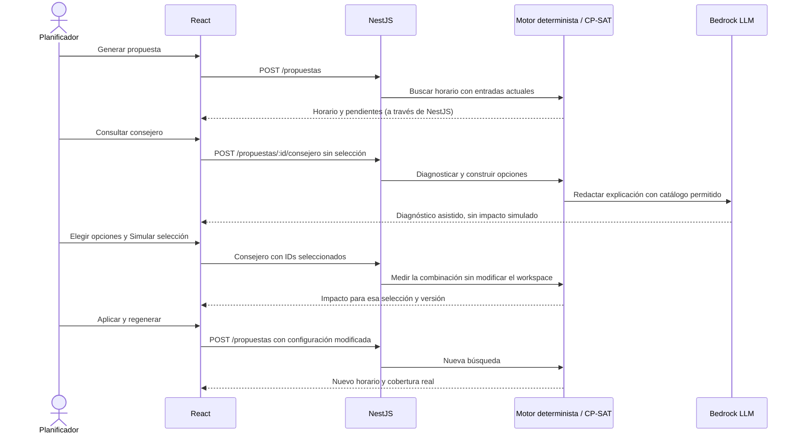

# Generar y mejorar un horario con ayuda del LLM

Guía y aceptación E2E del producto interno, ejecutada el **2026-11-17**. Se conserva la UI vigente de `/local/programacion-academica`: no se rediseñan pantallas ni se modifican contratos para esta prueba.

**Resultado:** el recorrido real en T3 Browser generó una propuesta parcial, recibió ayuda de Bedrock Nova Lite, simuló una selección humana y regeneró un horario con mayor cobertura. El resultado sigue siendo parcial y no quedó guardado ni publicado automáticamente.

## Qué aporta cada parte

- **React:** recoge cursos y recursos, presenta diagnóstico y opciones, conserva la selección y exige una simulación vigente para aplicar.
- **NestJS:** valida los contratos, conserva la propuesta y comprueba su identificación y versión antes y después de las operaciones.
- **Motor Python / CP-SAT:** busca las asignaciones de docente, ambiente, día y hora. También mide las opciones seleccionadas sobre una copia de las entradas.
- **Análisis determinista:** identifica cuellos de botella y construye el catálogo de cambios tipados. El orden del catálogo se mantiene aunque el modelo redacte la explicación.
- **LLM (Bedrock Nova Lite):** redacta el diagnóstico y las explicaciones a partir del análisis y del catálogo permitido. `source.mode=llm-assisted` acredita su participación en la respuesta del consejero; no significa que el modelo haya decidido las asignaciones del horario.
- **Planificador humano:** elige qué simular y si quiere aplicar los cambios. La simulación y la consulta normativa no conceden autorizaciones.



## Datos y alcance de esta ejecución

La procedencia se revisó antes de usar el navegador. El servicio de demostración usa `createDemoCatalog()` → `adaptSyntheticCatalog()` → `scenarioProgrammingRows`. La [semilla del repositorio](../../backend/src/matricula-regular/scenario-reference.seed.ts) declara expresamente que el operador confirmó su contenido enteramente sintético. La prueba no carga snapshots privados, no lee `datos-reales/` y no contacta SUM.

La confirmación de procedencia del operador se conserva como `testimony` en el encabezado de la semilla; las mediciones de esta prueba son `observed` locales y las decisiones de simulación del perfil son `local-only`. Ninguna de estas categorías acredita comportamiento de producción SUM.

Configuración observada:

| Campo | Valor |
| --- | --- |
| Facultad / escuela / periodo | FISI / Sistemas / **2027-I** |
| Catálogo | `PA-DEMO-1`, 56 cursos seleccionados |
| Perfil de planificación | `FISI-PLANNING-1`, periodo `2027-I` |
| Propuesta inicial | Tarde y sábado deshabilitados |
| Proveedor | `bedrock_converse / us.amazon.nova-lite-v1:0` |
| Selección aplicada | `rec-enable-planning-window` |
| Cambio | `allowAfternoon=true`, `allowSaturday=true` |

Este periodo es el seleccionado en la prueba, no una afirmación sobre reglas verificadas de 2026-II ni sobre otros perfiles. No se seleccionó ampliar carga docente. La habilitación de ventanas sigue mostrando que requiere autorización externa: en este ensayo sintético se mide y aplica una configuración local, no una autorización institucional.

## Reproducir manualmente en T3 Browser

Usa un entorno cuya procedencia sintética esté confirmada. `localhost` por sí solo no la acredita. Abre una pestaña nueva para no cambiar un workspace del operador que tenga trabajo sin guardar.

1. Abre `/local/programacion-academica`. En la instancia de esta sesión, el frontend está en `http://127.0.0.1:5636`; la dirección Tailscale vigente termina en `:10011/local/programacion-academica`.
2. Comprueba **Sistemas · 2027-I**. En **Oferta de cursos**, comienza con la oferta vacía y pulsa **Seleccionar los 56 cursos del catálogo**. Conserva los valores iniciales de demanda, capacidades, patrones y recursos.
3. Pulsa **Generar propuesta**. La UI debe mostrar Horario con cobertura y pendientes. Todavía no debe haberse enviado ninguna consulta al consejero.
4. Pulsa **Consultar consejero**. Espera el diagnóstico y las opciones. La respuesta HTTP de `/consejero` debe tener `source.mode=llm-assisted`, sin `verifiedImpact`; Aplicar debe estar deshabilitado. La UI debe mostrar narrativa y no el aviso «Sin redacción del modelo».
5. Conserva únicamente la opción que habilita tarde y sábado (`rec-enable-planning-window` en esta versión). Comprueba la advertencia de autorización. No marques ampliación de carga ni otra opción para reproducir este escenario.
6. Pulsa **Simular selección**. La petición lleva `selectedRecommendationIds`. La respuesta debe incluir `verifiedImpact.recommendationIds` con exactamente ese conjunto. La tarjeta muestra el resultado simulado y Aplicar queda habilitado.
7. Opcionalmente, marca y desmarca otra opción: el impacto debe quedar invalidado, incluso si vuelves a la combinación anterior. Debes volver a simular antes de seguir. Esta protección tiene evidencia en la [prueba previa de invalidación](../../evidence/local/consejero-llm-assisted-2026-11-17/t3-browser.json).
8. Pulsa **Aplicar 1 seleccionada y regenerar**. Debe producirse una nueva petición a `/propuestas`, un ID de propuesta nuevo y el resultado de cobertura realmente generado. No deduzcas ese resultado del pronóstico de la simulación: compruébalo en la nueva respuesta y la UI.
9. Revisa la cobertura, los pendientes y la vista **Semana** o **Tabla**. El resultado permanece en memoria hasta pulsar **Guardar**. Guardar, revisión docente, aprobación y publicación son acciones separadas y no forman parte de la aplicación automática del consejero.

En esta sesión se usaron **las herramientas nativas de T3 Browser**, por elección del usuario, no el MCP de Playwright conectado a otro Chromium. Se observaron respuestas reales mediante un observador de `fetch` que no alteró solicitudes ni respuestas; solo recogió modos, selección, configuración y contadores. Se retiró al terminar. No se capturaron claves, cookies ni cabeceras de autenticación.

## Reproducir automáticamente

El comando automatizado es una comprobación complementaria con Playwright headless; **no automatiza la pestaña de T3 Browser**. Arranca sus propios React, NestJS y Python, en los puertos 5436, 3436 y 3437, con un directorio temporal de borradores vacío. Al finalizar cierra los procesos que creó. No modifica el servicio persistente del operador ni la configuración Tailscale.

### Requisitos

- Node.js compatible con el repositorio (esta ejecución usa Node 24), pnpm y el entorno Python de `planning-engine/.venv` con sus dependencias instaladas.
- Backend compilado: `pnpm --dir backend build`. El runner usa `backend/dist/programacion-academica/local-main.js`; si cambias código del backend, recompílalo antes.
- Chromium de Playwright instalado para la versión del cliente: `pnpm --dir client exec playwright install chromium` si falta.
- Los tres puertos del stack de prueba libres. El runner aborta si están ocupados; no se conecta a otro servidor silenciosamente.
- Credencial Bedrock válida, acceso al modelo configurado y archivo de configuración explícito, fuera de Git y fuera de directorios privados prohibidos.

Ejemplo de **configuración**, sin una clave real:

```dotenv
AWS_REGION=us-east-2
SUM_LLM_MODEL=us.amazon.nova-lite-v1:0
AWS_BEARER_TOKEN_BEDROCK_FILE=/ruta/protegida/bedrock.key
```

La clave va en el archivo indicado, con acceso restringido. No se pega en comandos ni se incluye en evidencia. El lanzador [start-planning-engine-live.mjs](../../scripts/start-planning-engine-live.mjs) valida las rutas y entrega la configuración solo al proceso del motor, sin heredar snapshots, corpus ajenos ni perfiles AWS ambientales. Los demás tests conservan su LLM deshabilitado.

Desde la raíz del repositorio:

```sh
SUM_REDESIGN_LIVE_LLM=1 \
SUM_PLANNING_ENV_FILE=/ruta/operator.env \
SUM_REDESIGN_EVIDENCE=/tmp/generacion-horario-llm-e2e \
pnpm --dir client verify:planning-llm
```

El opt-in es explícito porque esta prueba efectúa llamadas reales al proveedor. El directorio de evidencia indicado se crea si falta; usa uno nuevo por ejecución si quieres conservar los resultados anteriores. Para cambiar puertos, define `SUM_REDESIGN_WEB_PORT`, `SUM_REDESIGN_API_PORT` y `SUM_REDESIGN_ENGINE_PORT` con tres valores distintos.

La salida correcta contiene diez criterios `PASS` y código de salida 0. `acceptance.json` contiene `passed=true`, modos reales, impacto simulado y las métricas de la regeneración. Un fallback determinista no se acepta como éxito del criterio `llm-assisted`.

## Resultado medido en T3 Browser

[Registro técnico de esta ejecución](../../evidence/local/generacion-horario-llm-2026-11-17/t3-browser.json), viewport 1280×800. Fuente de la afirmación: `observed`, aplicación local, condiciones y fecha de esta guía.

| Métrica | Inicial | Simulación | Regeneración real |
| --- | ---: | ---: | ---: |
| Sesiones asignadas | 211/332 | 243/332 | 243/332 |
| Sesiones pendientes | 121 | 89 | 89 |
| Secciones completas | 108/166 | 124/166 | 124/166 |
| Cruces docente/ambiente medidos | 0 | No comprobados por el observador de esta fase | 0 |
| Estado de búsqueda | `search-limit` | `search-limit` | `search-limit` |

La regeneración ganó **32 sesiones y 16 secciones completas**. Hubo dos generaciones: la inicial y la posterior a Aplicar. El conteo de borradores guardados se mantuvo en 1, correspondiente al estado previo del entorno persistente. La consulta y la simulación devolvieron `llm-assisted` y no hubo excepciones de página.

La coincidencia entre simulación y regeneración en esta ejecución no es una garantía general. Son búsquedas distintas con presupuesto limitado. El criterio automático exige mejorar la cobertura real para este escenario fijo y no tener cruces de docente/ambiente; no exige reproducir una cifra exacta del modelo ni una redacción idéntica.

## Criterios de aceptación y límites

| Criterio | Observación / comprobación | Esperado |
| --- | --- | --- |
| Horario inicial real | Respuesta `/propuestas`, conteos y pares de asignaciones | Propuesta parcial, cero cruces de docente/ambiente |
| Consulta bajo demanda | Conteo de peticiones antes del clic | Cero consultas al montar |
| Participación real del LLM | `source.mode` y narrativa visible | `llm-assisted` en consulta y simulación |
| Consulta sin simulación | Campo y herramientas de la respuesta inicial | Sin impacto ni ejecución de simulación |
| Aplicación protegida | Estado de Aplicar | Deshabilitado antes de simular |
| Selección exacta | IDs enviados y `verifiedImpact.recommendationIds` | Mismo conjunto |
| Regeneración controlada | Peticiones y nuevo ID | Una generación adicional al aplicar |
| Mejora real | Métricas de la nueva respuesta | Más sesiones y secciones completas, misma demanda |
| Recursos | Pares que coinciden en día y se solapan en minutos | Cero cruces de docente o ambiente |
| Persistencia y errores | Listado de borradores y eventos de página | Sin guardado implícito ni excepciones |

`search-limit` significa que terminó el presupuesto de búsqueda. Quedan 89 sesiones por resolver; este E2E **no acredita un horario completo, óptimo, aprobado ni publicado**. Tampoco audita todas las restricciones académicas: la comprobación adicional de cruces cubre docentes y ambientes, y no sustituye a las pruebas del solver sobre capacidad, disponibilidad, cohortes o reglas por periodo.

Si `source.mode` es `deterministic-fallback`, revisa el motivo devuelto: configuración, timeout, límite de proveedor, error remoto o salida inválida. No cambies el criterio para contar ese fallback como IA generativa. Una clave caducada o inaccesible debe corregirse en la configuración del operador; nunca registrarse en el reporte.

Los tiempos, el texto del LLM y la cobertura pueden variar con disponibilidad del proveedor, carga de la máquina, presupuesto de búsqueda o cambios en las semillas. Si cambia el catálogo, actualiza las precondiciones y revisa la expectativa de mejora; no traslades automáticamente este resultado a otra facultad o periodo.


## Ejecuciones automáticas de esta validación

Se conservaron **ambos intentos**, sin reemplazar el fallo con el resultado posterior:

- [Intento 1](../../evidence/local/generacion-horario-llm-2026-11-17/automatic-attempt-1.json): falló al exigir `llm-assisted`; el servicio devolvió `deterministic-fallback` con motivo `invalid_llm_output`. Los primeros dos criterios habían pasado. No se ejecutó Aplicar en ese intento.
- [Intento 2](../../evidence/local/generacion-horario-llm-2026-11-17/automatic-attempt-2.json): una única repetición con las mismas condiciones pasó los diez criterios, incluyendo la mejora de cobertura real y cero cruces de recursos. No se cambió el criterio ni se alteró el producto para obtener el pase.

Esto confirma una variación real del proveedor/formato de respuesta. La validación de la respuesta y el fallback funcionaron; el segundo pase **no demuestra que esa inestabilidad haya sido corregida**. El runner no oculta el fallback mediante reintentos automáticos: devuelve código 1 cuando aparece. La UI puede seguir con opciones deterministas, pero esa ejecución no satisface el criterio de participación generativa.

Capturas del intento satisfactorio, 1440×1000:

- [Diagnóstico asistido](../../evidence/local/generacion-horario-llm-2026-11-17/llm-assisted-analysis.png).
- [Selección simulada](../../evidence/local/generacion-horario-llm-2026-11-17/llm-assisted-simulated.png).
- [Horario realmente regenerado](../../evidence/local/generacion-horario-llm-2026-11-17/llm-assisted-regenerated.png).

Las capturas y las trazas usan únicamente la semilla de demostración confirmada sintética. Los JSON guardan solo criterios y mediciones pertinentes, sin credenciales ni cabeceras del proveedor.


## Objetivo actualizado: alcanzar el horario completo

El objetivo del usuario es cubrir **toda** la demanda. Los diez criterios anteriores acreditan generación asistida y mejora, pero **un pase con 243/332 no satisface ese objetivo**. La aceptación de completitud exige, en la regeneración real: todas las sesiones asignadas una vez, todas las secciones completas, cero pendientes, cero violaciones de restricciones y estado `complete`, con autorizaciones externas resueltas cuando correspondan. La simulación por sí sola no acredita esa aceptación.

Se investigó el mismo catálogo y demanda, sin aplicar los cambios al workspace:

| Condiciones | Resultado | Tipo de prueba |
| --- | --- | --- |
| Tarde/sábado + modalidad dividida | 243/332 sesiones, 124/166 secciones | Simulación real desde T3 Browser, `llm-assisted` |
| Las tres opciones del catálogo, incluyendo carga docente | 330/332 sesiones, 165/166 secciones | Simulación real desde T3 Browser, `llm-assisted` |
| Las tres opciones, con presupuestos 0.8, 2.5, 5 y 10 s | 330/332 en todos los ensayos, `search-limit` | Experimento CP-SAT aislado, mismas entradas sintéticas |
| Las tres opciones, estrategias `balanced` y `first-feasible`, 2.5 s | 330/332 en ambos ensayos | Experimento CP-SAT aislado |
| Las tres opciones + incremento dirigido de 120 minutos semanales en un docente elegible | **332/332 sesiones y 166/166 secciones**, `complete`, cero cruces de recursos y cero docentes sobre los nuevos límites | **Hipótesis local simulada**, no aplicada ni integrada como opción UI |

La sección que faltaba del curso `20118041` requiere dos sesiones de 180 minutos, a cargo del mismo docente responsable. En la solución parcial encontrada, sus docentes elegibles conservaban 240, 120 y 120 minutos libres: la capacidad estaba repartida y ninguno tenía 360 minutos libres para la sección. Esto describe esa solución; no prueba que otra redistribución global sea imposible. Dar más tiempo hasta 10 segundos y cambiar la estrategia no resolvió el pendiente en estos ensayos.

En una copia del escenario, se aumentó de 600 a 720 minutos el límite semanal del docente elegible que tenía ese límite de 600. El solver encontró un horario completo con 2.5 segundos de presupuesto. Son **minutos del modelo local**, no una conversión ni una autorización de horas lectivas normativas. No se probó que ese incremento sea necesario o mínimo globalmente.

### Cómo llevar la hipótesis completa al flujo real

1. Revisar las autorizaciones y límites del perfil para las ampliaciones de carga y ventanas. La prueba no concede esas autorizaciones.
2. Incorporar el cambio dirigido en una opción tipada revisada. Hoy los tres IDs del catálogo **no incluyen** los 120 minutos adicionales: el resultado 332/332 no se debe asociar a sus IDs actuales ni presentarse como aplicable.
3. Simular la selección completa revisada contra la propuesta y versión vigentes. Cambiar la selección o un límite invalida el impacto anterior.
4. Solo tras esa validación, aplicar y regenerar. El E2E de completitud debe comprobar el resultado real, no copiar los contadores simulados.
5. Guardar explícitamente el borrador si se desea conservarlo; revisión, aprobación y publicación siguen separadas.

Si la ampliación no se autoriza, corresponde buscar otra solución dentro de los límites aprobados: redistribuir secciones entre docentes elegibles con disponibilidad compatible o incorporar capacidad autorizada. El LLM puede explicar esas alternativas, pero su viabilidad debe medirse nuevamente. No se ha demostrado una solución completa con las condiciones originales ni una imposibilidad matemática.

### Evidencia de la investigación

- [Simulaciones desde la UI](../../evidence/local/generacion-horario-llm-2026-11-17/completion-ui-study.json).
- [Presupuestos de búsqueda](../../evidence/local/generacion-horario-llm-2026-11-17/completion-budget-study.json).
- [Estrategias alternativas](../../evidence/local/generacion-horario-llm-2026-11-17/completion-policy-study.json).
- [Hipótesis completa, condiciones y límites](../../evidence/local/generacion-horario-llm-2026-11-17/completion-hypothesis.json).

Los experimentos aislados reconstruyeron el workspace mediante los comandos públicos de sesión y una instancia nueva de `DemoProposalService`. Se observó su payload HTTP sintético hacia Python. Se reutilizaron `build_deterministic_analysis`, `run_cpsat_dry_run` y el solver real; solo se variaron el presupuesto, la estrategia o el límite declarado en una copia. No se modificó el código del producto, el servicio persistente ni los borradores. El payload de entrada con etiquetas no se incorpora a la evidencia: solo se conservan métricas y condiciones técnicas necesarias.
