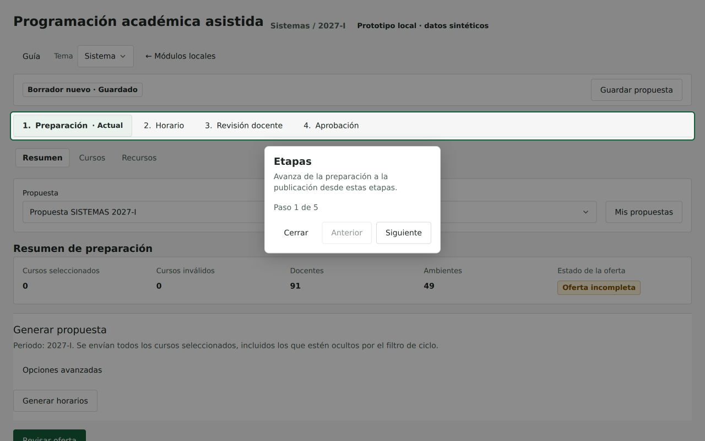
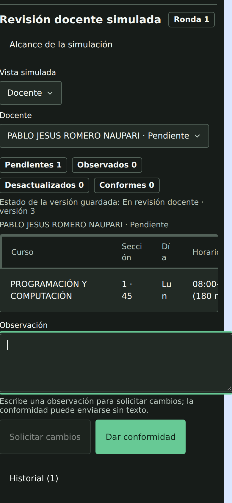
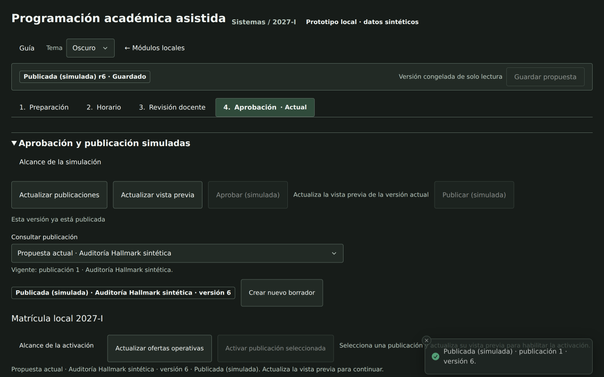

# Auditoría UX con Hallmark

Fuente: observación local del 2026-11-08, código `dfc13293a1a303b05661b50a0972d83890bfebcd`. Alcance: `/local/programacion-academica`, Sistemas / demo 2027-I. Criterios: solicitud del usuario, dirección visual A y Hallmark en scope app. No se cambia la aplicación en esta auditoría.

El objetivo del usuario es preparar una oferta, revisar su horario y llegar a una publicación válida sin depender de la guía. El ciclo de datos funciona; la interfaz todavía exige descubrir transiciones y contiene dos fallos reproducibles.

## Hallazgos priorizados

### UX-01 · P1 · La guía no avanza

**Reproducción:** Guía → Siguiente, cinco veces. Resultado: sigue «Etapas», «Paso 1 de 5»; Anterior sigue deshabilitado. Escape sí cierra y restaura el foco. También se observó en móvil que abrir Guía desde Horario cambia la ruta a Preparación/Resumen.

**Impacto:** el tutorial solicitado está incompleto y desplaza el contexto de trabajo. No debe ser necesario para descubrir el flujo.

**Evidencia:** [captura de escritorio](02-guide.png), [captura móvil oscura](07-mobileDarkTour.png), `browser-observations.json → tourSteps`.

**Localización:** `client/src/components/ui/Tour.tsx:613–650`, `:1492–1499`; `client/src/screens/AcademicScheduling.tsx:122–126`, `:511–530`. Hipótesis de código: el modo controlado escribe el valor en el store y retorna antes de notificar suscriptores; debe confirmarse al reparar. El fallo de avance está observado, la causa exacta es inferida.

**Corrección mínima:** reparar la sincronización del paso controlado y añadir una prueba que recorra los cinco pasos con clic y teclado. Al cerrar, conservar o recuperar el contexto previo cuando la guía haya cambiado de etapa.

### UX-02 · P1 · El campo de observación desborda el móvil

**Reproducción:** Revisión docente → Vista simulada Docente → viewport 390×844 → enfocar Observación docente.

**Resultado medido:** `document.scrollWidth = 404`, viewport 390; textarea con `box-sizing: content-box`, ancho CSS 366px y ancho exterior 392px. El foco desplaza lateralmente el documento. En escritorio también se midió textarea de 1258px dentro de región de 1232px.

**Evidencia:** [captura del fallo](09-mobileReview.png). Es un fallo de reflow, no el scroll interno esperado de una tabla ancha.

**Localización:** `client/src/components/ui/Textarea.tsx:5`, `client/src/screens/AcademicTeacherReview.tsx:96–101`, `client/src/components/PlanningShell.css:147`. La clase box-border existe; el estilo computado prueba que no gobierna este estado. Revisar la herencia y la cascada sin añadir `!important` ni cambiar el reset estudiantil.

**Corrección mínima:** asegurar border-box en el control y sus límites de ancho dentro del producto interno; probar 320/390px con foco y texto, además de zoom real.

### UX-03 · P2 · El estado global no describe el estado guardado

En una sesión nueva se muestra «Borrador nuevo · Guardado» aunque la lista de borradores está vacía. Después de enviar revisión o completar conformidad, la cabecera sigue diciendo «Borrador r3/r4», mientras el panel y la API indican «En revisión docente» / «Lista para aprobación». Las etiquetas aprobada/publicada sí se actualizan.

**Antipatrón:** falsa tranquilidad y dos estados distintos para un mismo documento.

**Evidencia:** [entrada vacía](01-entry.png), [revisión con estado contradictorio](08-teacherReview.png), E01/E09/E10. Localización: `PlanningScopeHeader.tsx:34–38`.

**Corrección mínima:** separar «sin cambios pendientes» de «guardado en disco» y cubrir todos los estados del contrato en la etiqueta global, sin duplicar resúmenes.

### UX-04 · P2 · Generar termina sin conducir al resultado

POST propuestas devuelve 200 y crea un horario completo, pero la UI permanece en Preparación/Resumen con «Generar horarios». El resultado y «Guardar borrador» se descubren entrando manualmente a Horario. En el vacío inicial, «Revisar oferta» empieza a y=779 en un viewport de 800px, detrás de la caja de generación.

**Antipatrón:** el siguiente paso válido queda separado de la acción que acaba de terminar; una acción repetible parece la salida del paso.

**Evidencia:** E05; [entrada](01-entry.png) y [resultado existente en Horario](05-schedule.png). Localización: `AcademicScheduling.tsx:133` y render de Preparación; acción primaria de `planningSession.ts:503–518`.

**Corrección mínima:** mostrar el resultado de la generación y un acceso inequívoco a Horario. Mantener una única acción primaria derivada de la sesión; no añadir otra barra ni depender del tour.

### UX-05 · P2 · La divulgación progresiva oculta decisiones esenciales

Al llegar a Aprobación desde «Ir a aprobación», el contenido está cerrado y no se ve Aprobar. Al abrirlo, hay que pulsar «Actualizar vista previa» para habilitar la decisión, entre controles de actualización con peso similar. En revisión, la vista predeterminada Escuela muestra un pendiente sin una indicación clara de que registrar respuesta requiere cambiar a Docente; la acción aparece después del cambio de vista.

**Antipatrón:** se oculta la tarea principal en vez de la evidencia secundaria. El usuario debe conocer controles internos para avanzar.

**Evidencia:** E09–E11; [revisión](08-teacherReview.png), [confirmación de aprobación](10-approvalConfirm.png). Localización: `AcademicPublicationPanel.tsx:48` (expanded false), `:279–283`; `AcademicTeacherReview.tsx:80–107`.

**Corrección mínima:** abrir la decisión válida al entrar en la etapa, mantener resumen/readiness visible y reservar el colapso para alcance e historial. Conservar la consulta de versión necesaria, pero resolver su carga sin un paso manual rutinario o explicar la razón junto a la acción.

### UX-06 · P2 · Error técnico sin orientación al campo

Guardar con nombre vacío no envía un POST, lo cual protege el documento. El mensaje visible es «No se guardaron los cambios. title: texto inválido» y el toast dice «La acción no se completó / Revisa el aviso para continuar». Corregir el título sí permite guardar.

**Antipatrón:** nombre interno del contrato y feedback genérico obligan al usuario a interpretar el error.

**Evidencia:** E15, `validationErrorSnapshot` observado durante la sesión; mensaje anotado en el informe E2E. Localización: validación previa de guardado en `planningSession.ts`, presentación de errores en `AcademicScheduling.tsx`.

**Corrección mínima:** «Escribe un nombre para la propuesta», asociado al campo y con foco cuando corresponda; conservar Sonner como apoyo, no como sustituto del error local.

### UX-07 · P3 · La migración aún arrastra estilos y densidad inconsistentes

En revisión/aprobación se midieron controles de 58px mientras los controles del kit suelen medir 40px; las cabeceras y celdas de tablas estrechas parten palabras cortas. En Horario se repite «Completa», «Programación completa» y el mismo estado en el título; su bloque ocupa 273px antes de la tabla en el caso de una sola sección.

**Antipatrón:** decoración y repetición consumen espacio por encima de los datos; los componentes tienen el mismo nombre de API pero no la misma presentación efectiva.

**Evidencia:** [horario](05-schedule.png), [revisión móvil](09-mobileReview.png), árbol y medidas de navegador. La tabla puede desplazarse horizontalmente; eso es correcto, la fragmentación extrema del texto no lo es.

**Corrección mínima:** retirar las reglas heredadas que cambian los controles migrados, compactar el resumen repetido y proteger el ancho legible de las columnas. Conservar los tokens y las separaciones de A.

## Qué ya funciona y conviene conservar

- Etapas numeradas y selección textual, subrutas de preparación y ausencia del sidebar redundante.
- Guardado/recuperación reales; Sonner comunica los efectos que no se ven directamente.
- AlertDialog en aprobación, publicación, nuevo borrador y descarte por periodo. Cancelar recibe el foco; Tab queda dentro y Escape restaura el foco.
- Publicación separada de aprobación, versión publicada bloqueada y creación de nuevo borrador con origen intacto.
- Tabla de cursos con scroll vertical y sticky comprobados mediante desplazamiento real de 600px.
- Semana cambia a agenda en móvil; los estados de esa vista y Cursos no desbordan el documento en los anchos probados.
- Paleta claro/oscuro por tokens y estados con texto. El check de contraste de tokens pasa; no equivale a una auditoría completa de contraste renderizado.

## Orden recomendado

1. Reparar UX-01 y UX-02 con regresiones de interacción y reflow.
2. Resolver estados y transiciones UX-03/04/05 para que el flujo se entienda sin guía.
3. Corregir errores de campo y la cascada visual UX-06/07.
4. Repetir teclado, zoom real 200%, móvil y los escenarios publicados/solo lectura. Añadir lector de pantalla y los flujos no cubiertos antes de declarar aceptación completa.

## Capturas del recorrido

1. Entrada: carga correcta, estado de guardado engañoso — [01](01-entry.png).
2. Guía: bloqueada en el primer paso — [02](02-guide.png), [07](07-mobileDarkTour.png).
3. Cursos: selección y contenedor desplazable operativos — [03](03-courses.png).
4. Recuperación: documento guardado disponible tras recargar — [04](04-savedList.png).
5. Horario: generación completa y resultados disponibles — [05](05-schedule.png), [06 móvil](06-mobileWeek.png).
6. Revisión: envío y conformidad funcionales; reflow defectuoso en Docente — [08](08-teacherReview.png), [09](09-mobileReview.png).
7. Aprobación: confirmación y cancelación correctas — [10](10-approvalConfirm.png).
8. Publicación: versión 6 vigente y de solo lectura — [11](11-published.png).

## Límites del juicio

Hallmark se usó como auditoría sobre un diseño existente y bloqueado, no como autorización de rediseño. Los avisos de su barrido estático se revisaron individualmente; los de tokens `.planning-root` y sellos no se cuentan como defectos UX. Su renderizador no estaba disponible; las observaciones de navegador proceden de T3 Preview. Ver [informe E2E](fullstack-verification.md) para comandos, resultados, procedencia y flujos no ejecutados. No se declara conformidad WCAG ni paridad SUM.
